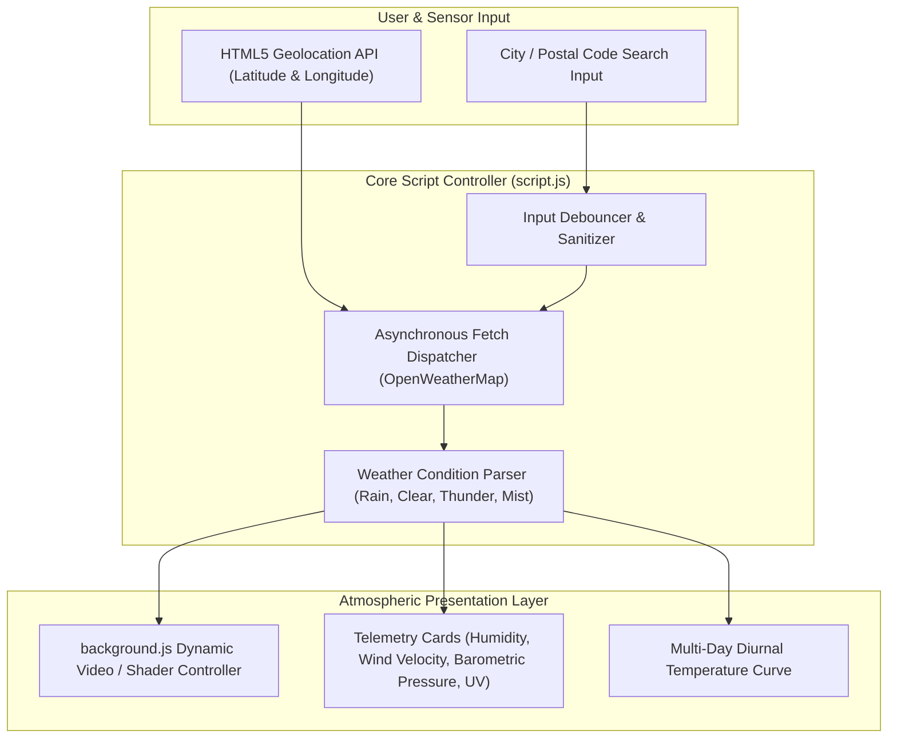

# Dynamic Meteorological Intelligence Interface

[](https://en.wikipedia.org/wiki/HTML5)
[](https://en.wikipedia.org/wiki/CSS)
[](https://developer.mozilla.org/en-US/docs/Web/JavaScript)
[](https://openweathermap.org/)
[](https://opensource.org/licenses/MIT)

A responsive, high-fidelity meteorological intelligence web dashboard engineered with vanilla modern **JavaScript (ES6+)**, **CSS3 Glassmorphism**, and asynchronous **RESTful weather APIs**. Features dynamic atmospheric canvas/video state rendering that automatically transitions based on real-time weather conditions.

---

## 🏛️ System Architecture



---

## ⚡ Engineering Highlights

1. **State-Driven Atmospheric Engine (`background.js`)**:
   - Automatically synchronizes background visual effects with the received OpenWeather condition code (e.g., triggering thunderstorm particle effects for codes `200-232`, gentle rain ripples for `500-531`, and haze/mist filters for `701-781`).
2. **Zero-Dependency Native Architecture**:
   - Constructed purely with vanilla Web standards to ensure lightning-fast Time to First Meaningful Paint (TTFMP) and minimal memory footprints across mobile and desktop browsers.
3. **Graceful Geolocation Fallback**:
   - Queries browser `navigator.geolocation` on initialization with seamless fallback to user search inputs upon permission denial.
4. **Resilient Error Boundaries**:
   - Catches 404 (City Not Found) and 429 (Rate Limit Exceeded) network responses, rendering contextual user recovery hints.

---

## 📂 Repository Structure

```text
Wheather-report-interface/
├── index.html                  # Semantic structural markup & responsive card layout
├── style.css                   # Glassmorphism aesthetic, keyframe animations & variables
├── script.js                   # API communication, metric parsing & DOM mutations
├── background.js               # Reactive atmospheric video & shader transitions
└── README.md
```

---

## 🚀 Getting Started

### 1. Clone the Repository
```bash
git clone https://github.com/ak-bharadwaj/Wheather-report-interface.git
cd Wheather-report-interface
```

### 2. Configure OpenWeather API Key
Open `script.js` and insert your [OpenWeatherMap API Key](https://openweathermap.org/api):
```javascript
const API_KEY = "your_actual_openweathermap_api_key_here";
```

### 3. Launch Locally
Simply open `index.html` in any modern web browser or serve it via a local static HTTP server:
```bash
# Using Python
python -m http.server 8080

# Using Node.js
npx serve .
```
Navigate to [http://localhost:8080](http://localhost:8080).
